# Kiến trúc & thiết kế

Tài liệu này gom các sơ đồ thiết kế của hệ thống. Mỗi sơ đồ là một file SVG vẽ tay trong `docs/diagrams/`
(tự đổi màu theo giao diện sáng/tối). Trang **Architecture** của web app hiển thị đúng các file này và cho tải về.
Ảnh PNG độ phân giải gấp đôi cho báo cáo: `python scripts/capture_figures.py --only diagrams`
(ra `reports/figures/diagram_*.png`).

## 1. Kiến trúc hệ thống (C4 – container)

Người dùng (chuyên viên tín dụng) dùng web dashboard; API trả lời từ kho DuckDB và mô hình DSS; ETL dựng kho từ file Kaggle.

- Kho là một file DuckDB: lưu theo cột, xử lý vector hoá, không cần chạy server. Nạp lại toàn bộ 2,6 GB CSV mất khoảng 40 giây.
- Chỉ API được đọc kho. Trình duyệt không gửi SQL: tên chiều và chỉ số được kiểm tra theo danh sách cho phép, giá trị lọc đi qua tham số.
- MotherDuck là bản sao trên cloud (không bắt buộc) để cả nhóm truy vấn mà không phải tải dữ liệu.

File: [`docs/diagrams/01_system_architecture.svg`](diagrams/01_system_architecture.svg)

## 2. Quy trình ETL

Bảy bước ghi vào file tạm; chỉ khi chạy qua hết mới thay kho đang dùng.

- Extract đọc mọi cột dạng chuỗi rồi `TRY_CAST` về kiểu khai báo, nên một giá trị lỗi không làm hỏng cả lần nạp 27 triệu dòng.
- Quy tắc làm sạch R1–R10 viết bằng pandas (dễ đọc, có unit test); phần gộp nặng viết bằng SQL (nhanh).
- Cổng chất lượng: khoá chính, khoá ngoại, đủ số dòng, đối soát tổng tiền giữa staging và fact.

File: [`docs/diagrams/02_etl_pipeline.svg`](diagrams/02_etl_pipeline.svg)

## 3. Star schema (fact constellation)

Hai bảng fact dùng chung dimension khách hàng và thời gian, nên có thể phân tích chéo (drill-across) từ hồ sơ vay sang khoản vay bureau.

- Grain: một hồ sơ vay (`SK_ID_CURR`) và một khoản tín dụng bureau (`SK_ID_BUREAU`).
- `dim_credit_history` là mini-dimension: hàng chục triệu dòng lịch sử gộp thành khoảng 200 hồ sơ đã chia bucket.
- `dim_bureau_category` là junk dimension; `dim_time` đóng hai vai trò (ngày mở, ngày tất toán) trên fact bureau.

File: [`docs/diagrams/03_star_schema.svg`](diagrams/03_star_schema.svg)

## 4. Data lineage

Mỗi bảng trong kho đến từ đâu: từ file Kaggle qua staging, bảng gộp, tới bảng của star schema.

- Các bảng con (1..N dòng mỗi khách) được gộp thành một hồ sơ tín dụng mỗi khách trước khi vào dimension.
- `fact_bureau_credit` giữ grain của bureau và nối về `dim_customer` để phân tích chéo.

File: [`docs/diagrams/04_data_lineage.svg`](diagrams/04_data_lineage.svg)

## 5. Luồng một truy vấn OLAP

Điều gì xảy ra khi người dùng bấm một cột: trạng thái lọc chung → gọi REST → SQL đã kiểm tra → kết quả được cache.

- Kết quả được nhớ theo (truy vấn, bộ lọc). Kho là snapshot tĩnh nên cache không bao giờ cũ cho tới lần ETL sau.
- Truy vấn lần đầu trên 356 nghìn hồ sơ mất 50–200 ms; lần sau dưới 5 ms.

File: [`docs/diagrams/05_request_flow.svg`](diagrams/05_request_flow.svg)

## 6. Luồng hệ hỗ trợ quyết định (DSS)

DSS gộp xác suất vỡ nợ của mô hình và các luật thẩm định thành một quyết định có giải thích.

- Mô hình train trên kho (`mart.v_application_wide`), không đọc file gốc, nên dashboard và mô hình thấy cùng một dữ liệu.
- Kết quả khắt khe nhất thắng, và mọi luật bị kích hoạt đều được liệt kê làm lý do.

File: [`docs/diagrams/06_dss_flow.svg`](diagrams/06_dss_flow.svg)

## Công nghệ

| Tầng | Công nghệ |
|---|---|
| Lưu trữ & OLAP | DuckDB (file local) · MotherDuck (bản cloud, không bắt buộc) |
| ETL | Python 3.12 · pandas · DuckDB SQL · CLI Typer (`hcdw`) |
| Backend | FastAPI · Uvicorn · SQL có kiểm tra tên, có cache |
| Frontend | React 18 · TypeScript · Tailwind CSS · Recharts · sơ đồ SVG vẽ tay |
| Hỗ trợ quyết định | LightGBM · scikit-learn · luật nghiệp vụ |
| Kiểm thử | pytest (ETL, API) · báo cáo chất lượng mỗi lần chạy |
