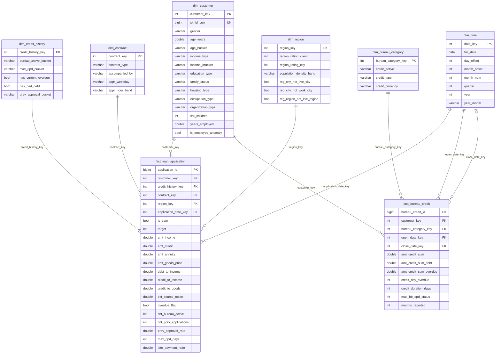

# Star schema - thiết kế kho dữ liệu

> Trạng thái: **bản nháp Day 1, đã rà soát lại ngày 10/11** (thêm `dim_bureau_category`, `close_date_key`). Cả nhóm review và chốt (freeze) lúc 21:00, 10/11. Mọi thay đổi sau giờ freeze phải cập nhật cả file này, `src/sql/ddl/` và `docs/etl_mapping.md`.

## 1. Bài toán & quy trình nghiệp vụ
Quy trình được mô hình hoá là **thẩm định hồ sơ vay** (loan underwriting). Câu hỏi phân tích chính:
khách hàng thuộc nhóm nào (tuổi, thu nhập, nghề, lịch sử tín dụng) có tỉ lệ vỡ nợ (default rate) cao, và một hồ sơ mới nên được duyệt, xem xét thêm hay từ chối.

## 2. Bus matrix

| Fact \ Dimension | dim_customer | dim_credit_history | dim_contract | dim_region | dim_bureau_category | dim_time |
|---|:-:|:-:|:-:|:-:|:-:|:-:|
| fact_loan_application | ✓ | ✓ | ✓ | ✓ |   | ✓ (ngày snapshot) |
| fact_bureau_credit    | ✓ |   |   |   | ✓ | ✓ ×2 (ngày mở, ngày tất toán) |

Hai fact dùng chung `dim_customer` và `dim_time` (conformed dimension), tạo thành một **fact constellation** và cho phép phân tích drill-across.
Ví dụ: trang Credit History lọc khách theo thuộc tính của hồ sơ vay, rồi đếm khoản vay bureau của đúng nhóm khách đó qua `customer_key`.

## 3. Grain
- `fact_loan_application`: **một hồ sơ vay** (`SK_ID_CURR`). Gồm cả tập train (có TARGET) và tập test (TARGET = NULL, `is_train = false`; DSS dùng để chấm điểm).
- `fact_bureau_credit`: **một khoản tín dụng** do Credit Bureau báo cáo (`SK_ID_BUREAU`).

## 4. Giả định về thời gian
Bộ dữ liệu **không có ngày thật**. Mọi cột thời gian là số ngày hoặc số tháng tính lùi từ ngày nộp hồ sơ (`DAYS_BIRTH`, `DAYS_CREDIT`, `MONTHS_BALANCE`). Nhóm cố định một **ngày snapshot giả định** `time.anchor_date` (mặc định 2018-05-17) trong `configs/settings.yaml`, và tính ngày = snapshot + offset.
Hệ quả: mọi hồ sơ trong `fact_loan_application` đều mang cùng một `application_date_key`. Phân tích theo thời gian vì vậy làm trên `fact_bureau_credit`. **Phải ghi rõ giả định này trong Chương 2 của báo cáo.**

`dim_time` là **role-playing dimension** trên `fact_bureau_credit`: `open_date_key` = snapshot + `DAYS_CREDIT` (luôn có), `close_date_key` = snapshot + `DAYS_ENDDATE_FACT` (chỉ khoản đã tất toán). Nguồn có vài giá trị `DAYS_ENDDATE_FACT` vô lý (hơn 100 năm trước, hoặc trước ngày mở), nên ETL để `close_date_key = NULL` cho các dòng đó thay vì kéo dài lịch. Khoá ngày được tra theo `dim_time.day_offset`, nên FK luôn trỏ tới một dòng có thật.

## 5. ERD

## 6. Quyết định thiết kế
| Quyết định | Lý do |
|---|---|
| Star schema chứ không dùng snowflake | Truy vấn dashboard chỉ cần 1 lần join mỗi chiều. Số dimension ít nên không cần chuẩn hoá thêm |
| `dim_credit_history` là **mini-dimension** (các thuộc tính đã chia bucket) | Lịch sử tín dụng gốc có tới hàng chục triệu dòng. Gộp thành vài trăm "hồ sơ" giúp lọc và nhóm nhanh, và không làm phình `dim_customer` |
| `dim_bureau_category` là **junk dimension** (trạng thái × loại tín dụng × tiền tệ, vài chục dòng) | Fact chỉ còn khoá và measure, không lặp lại chuỗi văn bản 1,7 triệu lần. Slice theo trạng thái hay loại vẫn chỉ cần một join |
| `dim_time` đóng hai vai trò trên `fact_bureau_credit` (ngày mở, ngày tất toán) | Dùng chung một bảng lịch, không phải tạo bảng ngày thứ hai. Ngày tất toán không dùng được thì để NULL (FK cho phép NULL) |
| Measure chi tiết (`max_dpd_days`, `prev_approval_rate`...) đặt trên fact | Bucket nằm ở dimension để slice; số liệu chính xác nằm ở fact để tính toán và cho model |
| Surrogate key bằng `ROW_NUMBER()` | Có thể tạo lại y hệt mỗi lần full refresh (dữ liệu là snapshot tĩnh) |
| SCD type 1 | Chỉ có 1 snapshot nên không có lịch sử thay đổi để lưu |
| Full refresh thay vì incremental | Nguồn là file tĩnh. Chạy lại toàn bộ chỉ mất vài phút với DuckDB |
| Build vào file tạm `hc.duckdb.building`, chạy xong mới thay file cũ | Lần chạy lỗi giữa chừng không làm hỏng kho đang dùng |
| Ràng buộc PK / FK / CHECK / NOT NULL | Kiểm tra toàn vẹn ngay lúc load. `quality.py` kiểm tra lại và xuất báo cáo |
